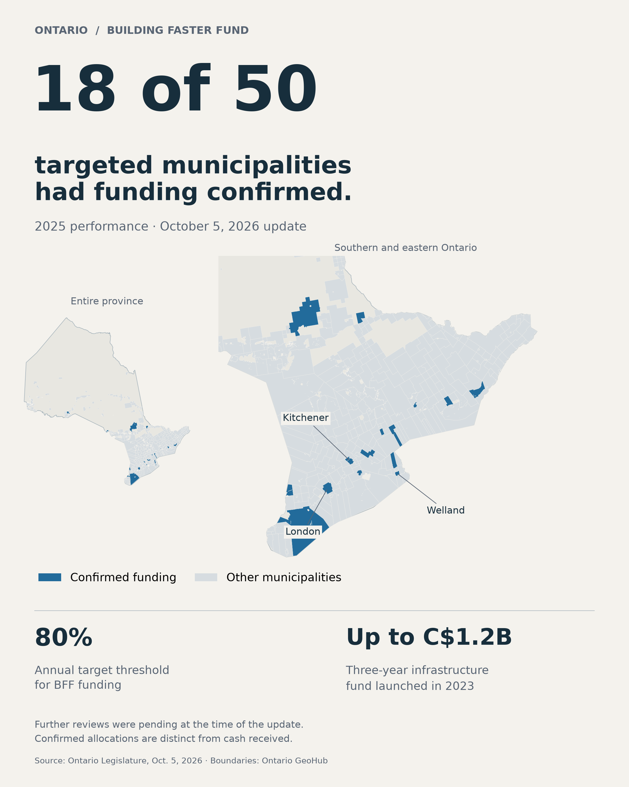

# Ontario Housing Audit

A reproducible municipal analysis of Ontario's **Building Faster Fund (BFF)**, residential construction and the federal **Housing Accelerator Fund (HAF)**. Maps, interactive controls, reports and project documentation are in English.



## What is the Building Faster Fund?

The BFF was Ontario's three-year program of **up to C$1.2 billion**, launched in August 2023 to support housing-enabling and community infrastructure. Its numeric funding threshold was **at least 80% of a municipality's annual housing target**. Reaching 100% means meeting the full target; it is a different measure.

Official housing progress combines conventional housing starts, additional residential units (ARUs), long-term-care beds, and, from 2024, postsecondary student beds and licensed congregate retirement-home suites. These categories must remain distinguishable when interpreting results.

Ontario has **444 municipalities**. The **50** in this study are the municipalities assigned individual provincial housing targets, not every municipality in Ontario. The map's lower-/single-tier GeoHub layer contains 414 municipalities; the remaining 30 are upper-tier governments.

Sources: [BFF launch](https://news.ontario.ca/en/release/1003397/to-build-more-homes-ontario-launching-building-faster-fund-and-expanding-strong-mayor-powers), [official housing tracker](https://www.ontario.ca/page/tracking-housing-supply-progress), [Ontario municipal list](https://www.ontario.ca/page/list-ontario-municipalities).

## Main finding and publication wording

> **Of Ontario's 50 municipalities with housing targets, 18 had Building Faster Fund financing confirmed in the October 2026 update.**

This refers to **2025 housing performance**, based on the official **October 5, 2026** statement. Further reviews were pending. It does **not** establish that the other 32 failed the funding threshold, that only 18 met 100% of their target, or that every announced amount has been received in cash.

[English LinkedIn draft](reports/linkedin_post.md) · [2025 funding evidence](reports/bff_2025_findings.md)

Publication image: [LinkedIn PNG — 2160 × 2700, 4:5](reports/bff_2025_linkedin.png) · [scalable SVG master](reports/bff_2025_linkedin.svg). The publication layout uses larger type, a shorter explanation and the same province-plus-detail map. It is rebuilt with `src.bff_evidence`.

## Maps and analysis

All main static maps retain the province-wide view plus southern/eastern detail, the established visual style and the same Ontario GeoHub snapshots projected to **EPSG:3347**. Interactive maps embed their data and geometry for offline use.

| Analysis | Scope and result | Outputs |
|---|---|---|
| BFF 2025 confirmed funding | 18 confirmed allocations among the 50 targeted municipalities; confirmed recipients highlighted | [PNG](reports/bff_2025_ontario_map.png), [HTML](reports/bff_2025_ontario_map.html), [report](reports/bff_2025_findings.md) |
| BFF 2025 residential comparison | Four documented award cases; same annual target, different housing measures | [PNG](reports/residential_bff_2025_ontario_map.png), [three-scenario HTML](reports/residential_bff_2025_ontario_map.html), [report](reports/residential_bff_2025_findings.md) |
| Residential units, 2025 | 54,032 starts in 49/50 municipalities; 60,786 completions in a different 42/50 coverage | [PNG](reports/residential_2025_ontario_map.png), [type/stage HTML](reports/residential_2025_ontario_map.html), [report](reports/residential_2025_findings.md) |
| BFF 2024 numeric threshold | 25/50 reached 80%; 15/50 reached 100% | [PNG](reports/bff_ontario_map.png), [HTML](reports/bff_ontario_map.html), [report](reports/bff_findings.md) |
| HAF annual-review permit performance | 32/48 municipalities with a numeric percentage below forecast; 16 at/above; two terminated agreements excluded | [PNG](reports/haf_ontario_map.png), [HTML](reports/haf_ontario_map.html), [report](reports/haf_map_findings.md) |
| Earlier provincial/federal case comparison | Selected Windsor/Oakville provincial awards and historical federal decisions | [Figure](reports/funding_contrast.png), [report](reports/funding_comparison.md) |

The 2025 funding map highlights the 18 confirmed allocations in blue. All other municipalities remain neutral grey geographic context. The interactive list and selection contain only the 18 confirmed allocations; performance percentages are kept in the research tables.

The residential/BFF comparison uses blue outlines for the 18 confirmed allocations. Only four annual targets are verified in that comparison; the other 46 remain yellow. The default PNG shows **new construction only**. Its HTML also switches to **self-contained units including verified ARUs** and **official BFF progress**.

## Housing definitions change the comparison

| Municipality | 2025 target | New-construction count used | % from new construction | Official BFF progress | Official % | Announced allocation C$ |
|---|---:|---:|---:|---:|---:|---:|
| London | 4,700 | 2,553 | 54.32% | 4,224 | 89.87% | 11,263,707 |
| Kitchener | 3,500 | 2,516 | 71.89% | 3,005 | 85.86% | 8,013,600 |
| Sarnia | 100 | 299 | 299.00% | 654 | 654.00% | 400,000 |
| Welland | 430 | 458 | 106.51% | 528 | 122.79% | 1,669,317 |

London and Kitchener total **C$19,277,307** in announced allocations while falling below 80% in the **new-construction-only counterfactual**. This does not establish improper funding or institutional-bed dependence.

Kitchener's release explicitly reports **2,516 starts + 489 ARUs = 3,005 units**, or **85.86%** of its target. Those independent units can house families. The archived December CMHC edition reported 2,416 starts; the later 100-unit difference is retained as a vintage difference, without changing archived dwelling-type counts. London still needs a component breakdown. Sarnia and Welland already clear the threshold with new construction alone.

Case-level sources: [comparison report](reports/residential_bff_2025_findings.md), [reviewed case registry](data/reference/bff_2025_comparison_cases.json), [merge audit](data/processed/residential_bff_2025/merge_audit.json).

## Residential units and families

The CMHC December 2025 edition provides annual municipal counts for single-detached, semi-detached, row, and apartment/other units. Within the available 49-municipality cohort, starts comprise **6,677 detached + 691 semi-detached + 7,665 row units = 15,033 houses**, plus **38,999 apartments and other**.

These are self-contained dwellings, not institutional beds or whole-building counts. A self-contained home occupied by a student or senior remains a residential unit. The table does not identify occupants, bedrooms, prices or affordability, so it cannot establish the number of families actually housed. Apartments and other includes duplexes and stacked townhouses. Existing-building conversions and ARUs are another series and are not silently added to new construction.

Starts are not completions. The 42-municipality completion total has different coverage from the 49-municipality start total; dividing them is not a completion rate. Completed homes may have started in earlier years.

Only explicit municipal CSD rows are used. **Woodstock CA is not substituted for Woodstock municipality**, which remains missing in this edition. The source is a historical December snapshot, not a claim to the latest revised data.

## Funding confirmation versus payment verification

Maps show **officially announced/confirmed allocations**. Program-specific cash receipts have not been reconciled.

The archived [Ontario Public Accounts payment schedule for 2025–2026](https://data.ontario.ca/en/dataset/public-accounts-detailed-schedule-of-payments/resource/3ab37bb7-4f51-4d90-951b-b9d566f65898) contains 16,142 records and no BFF-specific label. The ministry's municipal transfers aggregate programs. Its period ends **March 31, 2026**, before the June/July 2026 announcements used for the four 2025-performance cases.

[Payment-verification report](reports/bff_payment_verification.md) · [Structured audit](data/processed/public_accounts/bff_payment_audit.json)

Further verification requires municipal financial records identifying BFF receipts by program, instalment and date. The federal Grants and Contributions portal covers federal agreements and does not establish BFF payments; an agreement value is not proof of a disbursement.

## Reproduce the project

Use the Python interpreter configured in PyCharm. The current project environment is `.venv` (Python 3.13). Install pinned dependencies with:

```powershell
.\.venv\Scripts\python.exe -m pip install -r requirements-lock.txt
```

Rebuild all English reports and maps from archived sources:

```powershell
.\.venv\Scripts\python.exe -m src.build_reports
```

Individual analyses:

```powershell
.\.venv\Scripts\python.exe -m src.bff --year 2025
.\.venv\Scripts\python.exe -m src.compare_residential_bff
.\.venv\Scripts\python.exe -m src.residential --year 2025
.\.venv\Scripts\python.exe -m src.bff --year 2024
.\.venv\Scripts\python.exe -m src.plot_haf
.\.venv\Scripts\python.exe -m src.audit_payments
.\.venv\Scripts\python.exe -m unittest discover -s tests
```

The default `src.bff` selects the latest complete CSV year in the archived catalogue (currently 2024). Explicit `--year 2025` uses the reviewed multi-source registry. `--refresh` updates original downloads; reviewed extracts need a new human source review. Add source definitions to `data/reference/bff_2025_sources.json` to extend coverage without changing map code.

Validation of the English rebuild: **47 Python tests passed**, along with **40 headless Chrome interaction checks** across the 2025 funding, residential-unit and residential/BFF maps. Checks cover municipal coverage, missing values, exact percentages, allocation outlines, search, selection, inset reset and scenario changes. All seven PNG figures and the main interactive layout were visually reviewed.

## Sources, joins and provenance

- [Ontario Housing Supply Progress](https://data.ontario.ca/dataset/ontario-s-housing-supply-progress): complete reviewed municipal CSVs for 2023/2024. The aggregate without individual targets is excluded from municipal counts and retained in provincial totals.
- [CMHC municipal construction tables](https://www.cmhc-schl.gc.ca/professionals/housing-markets-data-and-research/housing-data/data-tables/housing-market-data/starts-completions-under-construction-census-subdivisions): December 2025 edition, annual columns from tables H6 and H11-3. `-` means zero; unavailable values stay missing.
- [Ontario Legislature, October 5, 2026](https://www.ola.org/en/legislative-business/committees/heritage-infrastructure-cultural-policy/parliament-44/transcripts/committee-transcript-2026-oct-05): 18 confirmed BFF allocations and pending reviews. Direct downloads returned 403; the local file is a clearly identified reviewed factual extract, not a full original snapshot.
- [CMHC HAF dashboard](https://www.cmhc-schl.gc.ca/professionals/project-funding-and-mortgage-financing/funding-programs/all-funding-programs/housing-accelerator-fund/housing-accelerator-fund-rounds-data): 61 Ontario communities, including 50 municipalities and 11 Indigenous governments retained outside the municipal map layer. Reporting cutoff is March 2026; it is not a common 2026 calendar-year total.
- [Ontario GeoHub municipal layer](https://geohub.lio.gov.on.ca/datasets/municipal-boundary-lower-and-single-tier): current display snapshots, same data across maps. Raw features include islands/parts and are dissolved by MUNID. Name normalization finds candidates; reviewed IDs distinguish Hamilton City from Hamilton Township and Peterborough City from other candidates. MUNID is not assumed to be CSDUID.

Original sources retain their original language. Download URLs, retrieval times and SHA-256 hashes are preserved in `data/raw/manifest.json`; individual analyses have source and join/merge audit JSON files. Unmatched, ambiguous or duplicate municipal joins fail the pipeline. Source percentage discrepancies are preserved in `data/processed/data_quality.json`.

Geometry is repaired and simplified for display, not area measurement. The current 2026 boundary snapshot is not a reconstructed 2024/2025 boundary.

## Project layout

```text
data/raw/                    Original sources and download manifest
data/reference/              Reviewed source definitions and factual case records
data/processed/              Derived tables, summaries, provenance and join audits
src/build_reports.py         English report/map rebuild command
src/bff.py                   Annual 80% performance map and 2025 registry routing
src/bff_evidence.py          HTML/PDF/reviewed-source evidence reconstruction
src/residential.py           CMHC municipal dwelling-type ingestion
src/compare_residential_bff.py Targets, residential measures and announced allocations
src/plot_residential_bff.py  Three-scenario funding comparison maps
src/audit_payments.py        Payment-schedule scope and reconciliation audit
src/plot_haf.py              HAF permit-forecast maps
src/templates/              English offline interactive map templates
reports/                    English maps, findings, research and post draft
tests/                      Source reconciliation and browser interaction checks
```
